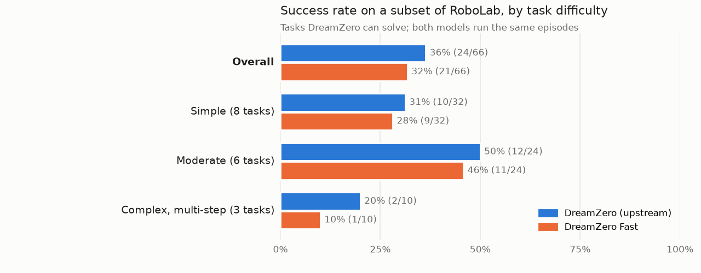

<div align="center">


**DreamZero as a real-time robot policy: an action chunk in about a quarter of a second.**

[🌐 Reactor](https://reactor.inc) · [📚 Docs](https://docs.reactor.inc) · [🛠️ Client SDKs](https://github.com/reactor-team/reactor-client-sdks) · [📖 Cookbook](https://github.com/reactor-team/reactor-cookbook)

</div>

---

[DreamZero](https://dreamzero0.github.io/) is a 14B world-action model for the DROID Franka arm. A
client sends three camera views and the robot's measured state, sets a task instruction, and
receives a chunk of 24 joint and gripper actions. DreamZero Fast serves the same
[DreamZero-DROID checkpoint](https://huggingface.co/GEAR-Dreams/DreamZero-DROID) on the
[Reactor Runtime](https://docs.reactor.inc/deploy), with the inference optimizations below.

| Configuration | GPUs | Time per action chunk |
|---|---|---|
| **DreamZero Fast** (shipped `config.yml`) | 2× B200 | **250 ms median** |
| One GPU, PyTorch denoising | 1× B200 | 677 ms median |

Measured on the public DROID checkpoint with 50 synthetic-observation steps after five warmup steps, six denoising steps and previews off. Timing includes observation preparation and inter-process communication, but excludes network transport. GPU count and precision both differ between these configurations; this is not a task-success or scaling comparison. See [benchmarking](docs/benchmarking.md).

## What makes it fast

Every optimization is a setting in [`dreamzero/config.yml`](dreamzero/config.yml), so you can turn
each one off and measure what it buys.

### ⚡ Two-GPU guidance

DreamZero uses classifier-free guidance, which means two denoiser passes per step: one conditioned
on the task and one unconditioned. With `num_gpus: 2`, the runtime runs one copy of the model per
GPU, each computes one branch, and they combine their predictions at every denoising step.
In matched tests, the one- and two-GPU paths produced bitwise-identical actions with the inference
settings held fixed.

### 🧮 TensorRT with NVFP4

The denoiser runs as a TensorRT engine with 4-bit NVFP4 weights instead of PyTorch. The engine is
built once for your host, and NVFP4 needs a Blackwell GPU. Toggle with `use_trt_engine`.

### 🎯 Fewer denoising steps

The upstream reference runs 16 solver steps. DreamZero Fast runs 6 (`num_inference_steps`), and the
action head reuses a flow prediction when a new one would barely change it
(`dynamic_cache_schedule`). Both settings can change the predicted actions.

### 🧊 Shorter image encode on a new plan

At the start of a plan, the action head conditions on one camera frame followed by 32 zero frames,
and passes all 33 through the VAE. The first chunk reads only the first three latent frames, and
the VAE is causal, so those depend only on the first 9 input frames. With `vae_prefix: true`, the
model encodes those 9 frames before the first chunk, then encodes the full clip on a side stream
after the chunk returns, while the robot executes it. The actions are unchanged; the first chunk
of each plan is about 90 ms faster when the client waits between requests.

### 📝 Instruction cache

The task instruction usually stays the same for many chunks. With `prompt_cache: true`, the text
embeddings are kept and reused until the instruction tokens change, so the text encoder does not
run on every chunk. The actions are unchanged.

### 🎥 Video only on demand

DreamZero predicts video alongside actions. Decoding it to pixels is skipped unless the client turns
on the preview, so a robot that only needs actions doesn't pay for it.

## Run it

You need an x86_64 Linux host with two Blackwell GPUs (B200) for the fast configuration, Docker with the NVIDIA
Container Toolkit, and the [`reactor` CLI](https://docs.reactor.inc/deploy). For one GPU, set `num_gpus: 1` and the manifest’s GPU count to 1. Keep `use_trt_engine: true` on a Blackwell GPU with a compatible engine; set it to `false` to use PyTorch denoising.

**1. Download the weights** into `dreamzero/weights/`: the DreamZero-DROID checkpoint and a Hugging
Face cache with the Wan2.1 components and the umt5-xxl tokenizer it loads. Allow additional disk space for engine-build files.

```sh
cd dreamzero
hf download GEAR-Dreams/DreamZero-DROID --local-dir weights/checkpoint
HF_HOME=weights/hf hf download Wan-AI/Wan2.1-I2V-14B-480P
HF_HOME=weights/hf hf download google/umt5-xxl --include "*.json" "spiece.model"
```

**2. Build the image.** `reactor build` renders it from the `build:` block of `reactor.yaml` and tags it
`reactor-local/dreamzero:dev`.

```sh
reactor build
```

**3. Build the TensorRT engine for the host, once.** The engine in the checkpoint is built for GB200 (aarch64), and a
TensorRT engine loads only on the platform it was built for. This replaces it with one for the host. To skip it, set `use_trt_engine: false` in `config.yml`; the model then denoises in PyTorch, several times
slower.

```sh
docker run --rm --gpus device=0 -v "$PWD/weights:/weights" \
  --entrypoint python reactor-local/dreamzero:dev scripts/build_trt_engine_local.py --weights /weights
```

**4. Serve it.** The model loads both GPUs and warms up before it accepts a session, which takes a few minutes.

```sh
reactor run --gpus '"device=0,1"' --shm-size 16g
```

**5. Drive it.** From the repository root, in a second terminal:

```sh
uv run client/policy_client.py --local
uv run client/policy_client.py --local --mode streamed
```

The client uses `reactor-sdk==1.13.0` and prints actions without executing them. It sends synthetic images by default; pass `--observations cameras.npz` for saved RGB arrays named `exterior_1`, `exterior_2` and `wrist`, each shaped `(T, H, W, 3)`. Use `--joints` and `--gripper` for measured robot state. Streamed mode publishes continuously at 10 frames per second; `--fps` changes that rate.

## Use it

A [stepped session](docs/serving.md#stepped-sessions) is the natural fit for a policy: each step sends what the robot
observed and returns the action chunk the model predicted from it.
[`client/policy_client.py`](client/policy_client.py) is the whole loop; its core is one call per chunk:

```python
reactor = Reactor("dreamzero-fast", local=True, generation="stepped")
await reactor.connect()
for camera in ("exterior_1", "exterior_2", "wrist"):
    await reactor.track(camera).publish()

result = await reactor.step(
    state={"prompt": "put the cup in the bowl", "joint_position": joints, "gripper_position": gripper},
    media={"exterior_1": [left], "exterior_2": [right], "wrist": [wrist]},
)
chunk = json.loads(result.track("predicted_video").frames[0].metadata)
robot.execute(chunk["actions"])  # 24 rows of 7 joint targets and 1 gripper target
```

Frame metadata includes equal top-level action fields and a `data` envelope; the client accepts either form. Streamed messages use the `data` envelope. The client uses the published SDK APIs.

A streamed session runs the same model on live camera tracks and sends each chunk as an `action_chunk` message.
[The serving guide](docs/serving.md) covers both, and the comments in [`config.yml`](dreamzero/config.yml) explain each
setting.

## Task success

DreamZero Fast runs fewer denoising steps at lower precision, so we checked that it still completes tasks like upstream DreamZero. Both ran the same episodes of the [RoboLab](https://github.com/NVlabs/RoboLab) simulation benchmark through RoboLab's own DreamZero client.



The comparison uses a subset of RoboLab tasks that DreamZero can solve, because tasks that both models always fail cannot show a difference. With a few episodes per task, read this as a check that Fast keeps DreamZero's task performance, not as a precise ranking.

## Development

Run the unit tests without a GPU or model weights:

```sh
cd dreamzero
make test
```

## Contributing

Contributions are welcome. See [`CONTRIBUTING.md`](CONTRIBUTING.md).

## License

The code is licensed under the [Apache License 2.0](LICENSE). Code imported from
[upstream DreamZero](https://github.com/dreamzero0/dreamzero) and its dependencies keeps its
original copyright and license headers. The DreamZero-DROID weights are released separately under
[CC BY-NC 4.0](https://creativecommons.org/licenses/by-nc/4.0/); review their terms before
downloading or deploying them.
